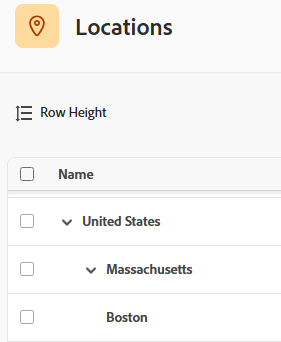

# Configurar ubicaciones

Puede configurar las ubicaciones predeterminadas disponibles para asignar como atributos a los roles en las tarjetas de tasas. Esto garantiza que las tarjetas de tarifas reflejen con precisión las tarifas de mercado en cada ubicación.

Las tarjetas de tarifas permiten a su organización administrar fácilmente las tarifas de facturación para los proyectos. Para obtener más información, consulte [Administrar tarjetas de tarifas](/help/quicksilver/administration-and-setup/manage-enterprise-operations/manage-rate-cards.md) y [Definir atributos de tarifas](/help/quicksilver/administration-and-setup/manage-enterprise-operations/define-rate-attributes.md).

## Requisitos de acceso

+++ Expanda para ver los requisitos de acceso para la funcionalidad en este artículo.

<table style="table-layout:auto"> 
 <col> 
 <col> 
 <tbody> 
  <tr> 
   <td>[!DNL Adobe Workfront] paquete</td> 
   <td>Workflow Ultimate</td> 
  </tr> 
  <tr> 
   <td>[!DNL Adobe Workfront] licencia</td> 
   <td>[!UICONTROL Standard]</td>
  </tr> 
  <tr> 
   <td>Configuraciones de nivel de acceso</td> 
   <td>[!UICONTROL System Administrator]</td> 
  </tr> 
 </tbody> 
</table>

Para obtener más información, consulte [Requisitos de acceso en la documentación de Workfront](/help/quicksilver/administration-and-setup/add-users/access-levels-and-object-permissions/access-level-requirements-in-documentation.md).

+++

## Añadir una ubicación

{{step-1-to-setup}}

1. En el panel izquierdo, haga clic en [!UICONTROL **Ubicaciones**].
1. Haga clic en [!UICONTROL **Nueva fila**] al final de la lista.
1. Introduzca el nombre de la ubicación y la descripción.
1. Haga clic fuera de la fila para guardar la ubicación.
1. Para eliminar una ubicación, selecciónela en la lista y haga clic en [!UICONTROL **Eliminar**] en la barra de acciones de la parte inferior de la pantalla.

>[!NOTE]
>
>No se pueden eliminar las ubicaciones asociadas con funciones en una tarjeta de tarifas.

## Añadir una sububicación

Puede agregar una sububicación a una ubicación existente. Por ejemplo, si ya tiene una ubicación de Reino Unido, Londres podría ser una sububicación.

Se permiten tres niveles de sububicaciones. El país, el estado o la provincia y la ciudad son usos comunes de las sububicaciones.

Cada sububicación se puede agregar como atributo en una tarjeta de tasa de la misma manera que una ubicación de nivel superior, para definir la tasa para un rol específico en esa ubicación.

{{step-1-to-setup}}

1. En el panel izquierdo, haga clic en [!UICONTROL **Ubicaciones**].
1. Seleccione una ubicación existente en la lista y haga clic en [!UICONTROL **Agregar ubicación secundaria**] en la barra de acciones de la parte inferior de la pantalla.
1. Introduzca el nombre de la ubicación y la descripción.
1. Haga clic fuera del área de entrada para guardar la ubicación.

   La sububicación tiene sangría debajo de la ubicación de nivel superior.

   

