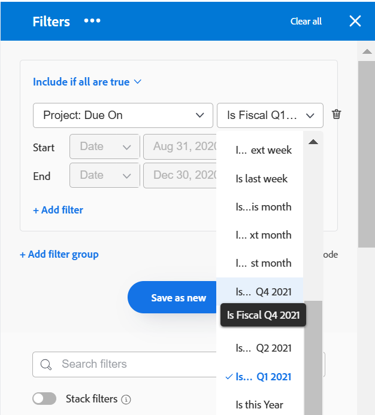

# Habilitar trimestres y semanas personalizados

<!--Audited: 03/2026-->

<!--remove Production and Preview references at release-->

<!--

The highlighted information on this page refers to functionality not yet generally available. It is available only in the Preview environment for all customers. After the monthly releases to Production, the same features are also available in the Production environment for customers who enabled fast releases.    

For information about fast releases, see [Enable or disable fast releases for your organization](/help/quicksilver/administration-and-setup/set-up-workfront/configure-system-defaults/enable-fast-release-process.md). 
-->

Con fines de creación de informes, es posible que desee crear trimestres personalizados si los trimestres de su organización se basan en criterios específicos distintos de las fechas del calendario (como días laborables o días de compras).

Según los productos que haya adquirido su compañía, puede configurar el siguiente número de trimestres en el área Configuración de Workfront:

* Los clientes que solo compraron [!DNL Workfront], pueden configurar hasta ocho trimestres personalizados para su sistema [!DNL Adobe Workfront].
* Los clientes que compraron [!DNL Workfront] y [!DNL Workfront Planning], pueden configurar hasta 100 trimestres para su sistema [!DNL Workfront], que también están disponibles en [!DNL Planning].

* Los clientes que compraron [!DNL Workfront] y [!DNL Workfront Planning], pueden configurar semanas personalizadas para cada trimestre personalizado. Las semanas personalizadas están visibles en las vistas de escala de tiempo de [!DNL Planning].

## Requisitos de acceso

+++ Expanda para ver los requisitos de acceso para la funcionalidad en este artículo.

<table style="table-layout:auto"> 
 <col> 
 <col> 
 <tbody> 
  <tr> 
   <td>[!DNL Adobe Workfront] paquete</td> 
   <td>
Cualquiera
</td> 
  </tr> 
  <tr> 
   <td>[!DNL Adobe Workfront] licencia</td> 
   <td>
Licencia de [!UICONTROL Workflow Standard] o [!UICONTROL Workfront Plan]

       

</td>
  </tr> 
  <tr> 
   <td>Configuraciones de nivel de acceso</td> 
   <td>[!UICONTROL System Administrator]</td> 
  </tr> 
 </tbody> 
</table>

Para obtener más información, consulte [Requisitos de acceso en la documentación de Workfront](/help/quicksilver/administration-and-setup/add-users/access-levels-and-object-permissions/access-level-requirements-in-documentation.md).

+++

<!--
When we release fiscal weeks, replace the table above with this:

<table style="table-layout:auto"> 
 <col> 
 <col> 
 <tbody> 
  <tr> 
   <td>[!DNL Adobe Workfront] package</td> 
   <td>
   <ul>
   <li>
To configure custom quarters:

   
Any Workfront or Workflow package
</li>
   <li>
   

   
To configure custom weeks:

   
Any Planning package, including Planning as a standalone product

   

   </li>
   </ul>
   </td> 
  </tr> 
  <tr> 
   <td>[!DNL Adobe Workfront] license</td> 
   <td>
   
   <ul>
   <li>
To configure custom quarters:

   
[!UICONTROL Workflow Standard] or [!UICONTROL Workfront Plan] license
</li>
   <li>
   

   
To configure custom weeks:

   
A [!UICONTROL Planning Standard] license, in addition to a Workfront or a Workflow license

   

   </li>
   </ul>
    </td>
  </tr> 
  <tr> 
   <td>Access level configurations</td> 
   <td>[!UICONTROL System Administrator]</td> 
  </tr> 
 </tbody> 
</table>

-->

## Configurar trimestres personalizados para su sistema [!DNL Workfront]

<!--
Setting up custom quarters differs depending on which environment you use. 

### Set up custom quarters for your [!DNL Workfront] system in the Production environment

{{step-1-to-setup}}

1. Click **[!UICONTROL Custom Quarters]**.

1. Select **[!UICONTROL Enable Custom Quarters]**.

1. Type a name for the custom quarter, such as "Fiscal Q1 2021."
1. Select start and end dates for the custom quarter.

   

1. (Optional) Click **[!UICONTROL Add Custom Quarter]** to add additional custom quarters to the system.

      >[!IMPORTANT]
      >
      > If your company purchased [!DNL Workfront Planning], you cannot save your custom quarters if there are gaps or overlaps between the quarters. 
      >
      >Gaps and overlaps between the quarters are allowed for [!DNL Workfront] only customers. 

1. (Optional and conditional) If your company purchased only [!DNL Workfront], without [!DNL Workfront Planning], create a reporting element that refers to the fiscal quarters.

   **Example:** Create a filter for a [!UICONTROL project] list and include the Planned Completion Date of a project referencing the custom quarters.

   

   The references to "This Quarter", "Next Quarter", and "Last Quarter" are replaced with new references to the custom quarters.

   For information about reporting elements, see [Reporting elements: filters, views, and groupings](../../../reports-and-dashboards/reports/reporting-elements/reporting-elements-filters-views-groupings.md).

   For information about creating filters, see [Create or edit filters in [!DNL Adobe Workfront]](../../../reports-and-dashboards/reports/reporting-elements/create-filters.md).
1. (Optional and conditional) If your company purchased Workfront Planning and you have access to [!DNL Workfront Planning], go to a record type page and open a timeline view. The view displays the new custom quarters. 
For information, see [Manage the timeline view](/help/quicksilver/planning/views/manage-the-timeline-view.md). 

### Set up custom quarters for your [!DNL Workfront] system in the Preview environment

-->

>[!NOTE]
>
>Si su organización ha adquirido un paquete de Planning además de un paquete de flujo de trabajo, o si ha adquirido Workfront Planning como paquete independiente, puede configurar semanas personalizadas además de trimestres personalizados.
> 
>Las semanas personalizadas no están disponibles para informes y listas de Workfront.

{{step-1-to-setup}}

1. Haga clic en **[!UICONTROL Trimestres personalizados]**.

1. Seleccione **[!UICONTROL Habilitar trimestres personalizados]**.

1. Escriba un nombre para el trimestre personalizado. Por ejemplo, &quot;Primer trimestre fiscal de 2021&quot;.
1. Seleccione las fechas de inicio y finalización del trimestre personalizado.

1. (Opcional) Seleccione la opción **Inicia una nueva secuencia de semanas personalizada**.

   Cuando se selecciona esta opción, el inicio del trimestre personalizado se establece como el inicio de la primera semana personalizada del trimestre en la vista de línea de tiempo de Planning.
1. (Opcional) En el área **Formato de etiqueta de semana personalizado**, elija el **Formato** para las etiquetas de semana personalizadas. Elija entre las siguientes opciones:

   * **W1, W2, W3 ...** . Este es el formato predeterminado.
   * **FW1, FW2, FW3...**
   * **Semana1, Semana 2, Semana 3, ...**
   * **Personalizada**

1. (Condicional) Si seleccionó **Personalizado** para el campo **Formato**, escriba una **Etiqueta personalizada** para identificar las semanas personalizadas.

   Las semanas personalizadas se muestran en las vistas de cronología de Planning.

   >[!TIP]
   >
   >Al agregar una etiqueta personalizada, puede escribir hasta 100 caracteres.
   >
   >Puede indicar el nombre de la primera semana, y las semanas siguientes utilizarán la misma etiqueta seguida de un número secuencial.
   >
   >Por ejemplo, una **etiqueta personalizada** de &quot;semana fiscal&quot; agregará las etiquetas de &quot;semana fiscal 1, semana fiscal 2, semana fiscal 3...&quot; al resto de las semanas de la secuencia.

1. (Opcional) Haga clic en **[!UICONTROL Add Custom Quarter]** para añadir trimestres personalizados adicionales al sistema.

   >[!IMPORTANT]
   >
   > Si su compañía compró [!DNL Workfront Planning], no puede guardar los trimestres personalizados si hay espacios o superposiciones entre los trimestres.
   >
   >Solo se permiten espacios y superposiciones entre los trimestres para [!DNL Workfront] clientes.

1. (Opcional y condicional) Para ver los trimestres personalizados en Workfront, cree un elemento de sistema de informes que haga referencia a los trimestres personalizados.

   **Ejemplo:** cree un filtro para una lista de [!UICONTROL project] e incluya la fecha planificada de finalización de un proyecto que haga referencia a los trimestres personalizados.

   

   Las referencias a “Este trimestre”, “Próximo trimestre” y “Último trimestre” se sustituyen por nuevas referencias a los trimestres personalizados.

   Para obtener información acerca de los elementos de informes, consulte [Elementos de creación de informes: filtros, vistas y agrupaciones](../../../reports-and-dashboards/reports/reporting-elements/reporting-elements-filters-views-groupings.md).

   Para obtener información acerca de cómo crear filtros, consulte [Crear o editar filtros en [!DNL Adobe Workfront]](../../../reports-and-dashboards/reports/reporting-elements/create-filters.md).
1. (Opcional y condicional) Para ver trimestres y semanas personalizados en Workfront Planning, vaya a una página de tipo de registro y abra una vista de cronología. La vista muestra los nuevos trimestres y semanas personalizados.

   Para obtener más información, consulte [Administrar la vista de cronología](/help/quicksilver/planning/views/manage-the-timeline-view.md).

