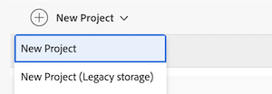

# Habilitar el almacenamiento en la nube de Adobe para su organización

El almacenamiento en la nube de Adobe es una solución de almacenamiento unificada y basada en la nube que sirve como repositorio central para los recursos de los productos empresariales de Adobe. En este artículo se describe cómo habilitar el almacenamiento en la nube de Adobe como la opción de almacenamiento predeterminada para toda la organización o para grupos específicos.

Esta es la única acción que activa la nueva experiencia: una vez habilitada, los nuevos proyectos utilizan el almacenamiento en la nube de Adobe, que incluye el visor Frame.io y las aprobaciones unificadas. Nada cambia hasta que elija habilitar el almacenamiento en la nube de Adobe.

Dado que controla el tiempo, puede probar la experiencia, actualizar los escenarios de Workfront Fusion y planificar los cambios de los informes antes de que alguien trabaje en ella. Para obtener más información sobre las diferencias y cómo planificar la implementación, consulte [Mover a Workfront en el almacenamiento en la nube de Adobe](/help/quicksilver/review-and-approve-work/workfront-storage.md).

## Funcionamiento de las aprobaciones con el almacenamiento en la nube de Adobe

El almacenamiento en la nube de Adobe determina qué servicio de aprobación utiliza un proyecto. El paso a una versión de Workfront compatible con el almacenamiento en la nube de Adobe no cambia automáticamente toda su organización a Aprobaciones unificadas. En su lugar, el servicio de aprobación depende del modelo de almacenamiento de cada proyecto:

* **Los proyectos de almacenamiento en la nube de Adobe** utilizan aprobaciones unificadas de forma predeterminada, con revisión y aprobación en el visor de Frame.io.
* **Los proyectos de almacenamiento de Workfront heredados** conservan el servicio de aprobación que ya usan. Según su organización, podrían ser aprobaciones unificadas o aprobaciones de documentos heredados.

Para obtener más información sobre la experiencia de revisión y aprobación del almacenamiento en la nube de Adobe, consulte [Mover a Workfront en el almacenamiento en la nube de Adobe](/help/quicksilver/review-and-approve-work/workfront-storage.md).

## Requisitos de acceso

+++ Expanda para ver los requisitos de acceso para la funcionalidad en este artículo.

<table style="table-layout:auto"> 
 <col> 
 <col> 
 <tbody> 
  <tr> 
   <td role="rowheader">Paquete de Adobe Workfront</td> 
   <td>
Cualquier paquete de flujo de trabajo
</td> 
  </tr> 
  <tr> 
   <td role="rowheader">Licencia de Adobe Workfront</td> 
   <td>
Estándar
 
Plan
</td> 
  </tr> 
  <tr> 
   <td role="rowheader">Configuraciones de nivel de acceso</td> 
   <td>Debe ser administrador de Workfront. </td> 
  </tr> 
 </tbody> 
</table>

Para obtener más información, consulte [Requisitos de acceso en la documentación de Workfront](/help/quicksilver/administration-and-setup/add-users/access-levels-and-object-permissions/access-level-requirements-in-documentation.md).

+++

## Habilitar el almacenamiento en la nube de Adobe para su organización

Para habilitar el almacenamiento en la nube de Adobe para su organización:

{{step-1-to-setup}}

1. Seleccione **Sistema** en el panel de navegación izquierdo, luego seleccione **Preferencias**.
1. Desplácese hacia abajo hasta la sección **Preferencias de almacenamiento**.
1. En el menú desplegable Predeterminado, seleccione **Adobe Cloud Storage**.
1. (Opcional) Si desea utilizar una combinación de almacenamiento en la nube de Adobe y almacenamiento de Workfront heredado, active la casilla de verificación **Permitir que el usuario seleccione el proveedor de almacenamiento**.

   >[!NOTE]
   >
   >Al habilitar esta opción, los usuarios pueden seleccionar el proveedor de almacenamiento cuando creen un nuevo proyecto. El almacenamiento en la nube de Adobe está etiquetado como &quot;Nuevo proyecto&quot; porque es el proveedor de almacenamiento predeterminado. El almacenamiento heredado de Workfront está etiquetado como &quot;Proyecto heredado&quot;.
   >
   >

1. En el menú desplegable Se aplica a, elija una de las siguientes opciones:

   * **Organización completa**: esta opción aplica el proveedor de almacenamiento predeterminado a todo el entorno de Workfront. Cada vez que un usuario cree un nuevo proyecto, se utilizará el proveedor de almacenamiento predeterminado.
   * **Grupos específicos**: esta opción aplica el proveedor de almacenamiento predeterminado solamente a grupos específicos dentro de su organización. Cada vez que un usuario de los grupos especificados cree un nuevo proyecto, se utilizará el proveedor de almacenamiento predeterminado.

     

1. Haga clic en **Guardar**.

   >[!NOTE]
   >
   >Los proyectos existentes mantienen el modelo de almacenamiento con el que se crearon. Por ejemplo, los proyectos que utilizan el almacenamiento en la nube de Adobe siguen utilizando el almacenamiento en la nube de Adobe después de cambiar la preferencia de almacenamiento predeterminada.

## Almacenamiento en la nube de Adobe en entornos de espacio aislado

El almacenamiento en la nube de Adobe está disponible en [!DNL Workfront] entornos de espacio aislado, lo que le permite probar la funcionalidad descrita en este artículo antes de implementarla en la producción. Sin embargo, el visor Frame.io no está disponible en la zona protegida, por lo que la experiencia completa de revisión y aprobación unificadas debe validarse en la producción.

Si tiene una zona protegida de actualización personalizada, debe actualizarla después de actualizar a una versión de Workfront que admita el almacenamiento en la nube de Adobe. La actualización proporciona al entorno limitado acceso a la funcionalidad de almacenamiento en la nube de Adobe para que pueda empezar a probarla. Para obtener más información, consulte [El [!DNL Adobe Workfront] entorno de espacio aislado de actualización personalizado](/help/quicksilver/administration-and-setup/set-up-workfront/workfront-testing-environments/wf-custom-refresh-sandbox-environment.md).
