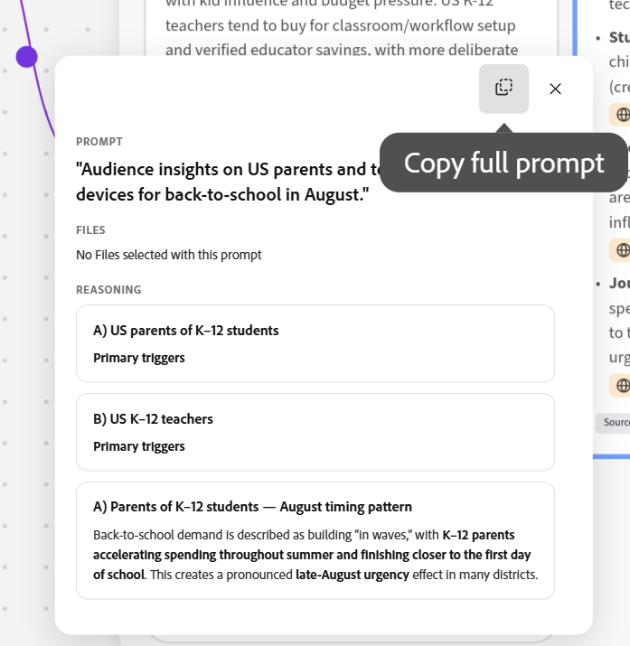

# Creación de informes en el espacio de ideación

<!--add to TOC and miniTOC-->

La información de esta página hace referencia a una funcionalidad que aún no está disponible de forma general. Solo está disponible como parte del programa **Beta** del espacio de ideación. 

Para obtener más información, consulte [Introducción al espacio de ideación para Adobe Workfront Planning](/help/quicksilver/planning/ideation/get-started-with-planning-ideation.md).

{{planning-important-intro}}

Con el Espacio de ideas, una nueva funcionalidad de Adobe Workfront Planning, puede convertir informes en registros de Planning o guardarlos como un archivo externo. Los informes exportados crean registros nuevos o actualizan los existentes.

Este artículo describe cómo puede crear ideas y estrategias en el espacio de ideación para crear informes.

Puede hacer lo siguiente:

* Para crear o actualizar registros, exporte los informes de ideación finalizados a Workfront Planning.

* Para utilizar la información de un resumen en otra aplicación, exporte la información a uno de los siguientes tipos de archivo:

  * PDF
  * Palabra
  * PowerPoint
  * Plantilla de PowerPoint

## Requisitos de acceso

+++ Expanda para ver los requisitos de acceso para la funcionalidad en este artículo. 

<!--
are there additional license restrictions or packages to be purchased to have access to Ideation space?? If yes, update the table below
-->

<table style="table-layout:auto"> 
<col> 
</col> 
<col> 
</col> 
<tbody> 
    <tr> 
<tr> 
</tr>   
<tr> 
   <td role="rowheader">
Paquete de Adobe Workfront
</td> 
   <td> 
<ul> 
<li>
Cualquier Workfront o flujo de trabajo con un paquete de Planning
</li>
<!--
Add this at GA - not available in beta:
Or
<li>
Any Planning package when purchased as a standalone product
</li>
-->
</ul>
   </td> 
<!--
<tr> 
<td role="rowheader">
Additional products
</td> 
<td><ul>
<li>
Adobe GenStudio for Performance Marketing
</li>
<li>
Adobe Customer Journey Analytics
</li>
</ul>
</td> 
</tr> 
-->
  <tr> 
   <td role="rowheader">
Licencia de Adobe Workflow
</td> 
   <td>
Estándar

   </td> 
  </tr> 
<tr> 
   <td role="rowheader">
Licencia de planificación de Adobe
</td> 
   <td>
Estándar

   </td> 
  </tr>  
<tr> 
   <td role="rowheader">
Configuración de nivel de acceso
</td> 
   <td> 
   <ul>
   <li>
Debe agregar un tipo de licencia de flujo de trabajo y de Planning al nivel de acceso cuando tenga un flujo de trabajo y un paquete de Planning a la vez
   </li>
   <li>
La configuración Deshabilitar espacio de ideación en su nivel de acceso debe estar deseleccionada
</li>
</td> 
  </tr>  
   <tr> 
   <td role="rowheader">
Permisos de objeto
</td> 
   <td> 
Permisos de contribución o superiores al espacio de trabajo y tipo de registro donde desee agregar registros 

      
Los administradores del sistema tienen permisos para todos los espacios de trabajo, incluidos los que no crearon

      <!--
      not available right now:
      
View permissions to Workfront objects to add them to briefs 

      -->
      
Permisos de editor en el espacio de ideación para crear informes

   </td> 
  </tr>  
    <!--
    <tr> 
    <td role="rowheader">
Adobe GenStudio for Performance Marketing user roles
</td> 
    <td>
<ul><li>Any GenStudio user role to access Campaigns, Products, and Personas</li>
    <li>GenStudio System Manager to access Activations and Events</li></ul>
    For information, see <a href="https://experienceleague.adobe.com/en/docs/genstudio-for-performance-marketing/user-guide/intro/user-roles">User roles and permissions</a>. 
    

    </td> 
    </tr> 
    -->
</tbody> 
</table>

Para obtener más información acerca de los requisitos de acceso de Workfront, consulte [Requisitos de acceso en la documentación de Workfront](/help/quicksilver/administration-and-setup/add-users/access-levels-and-object-permissions/access-level-requirements-in-documentation.md).

+++  

## Creación de informes de espacio de ideación

Puede crear informes para crear o editar registros de Planning o para crear archivos que se pueden exportar a otras aplicaciones.

1. Inicie sesión en Workfront con Planning donde se ha activado el compañero y realice una de las siguientes acciones:

   * Vaya a **Menú principal** > **Espacio de ideación**
   * Vaya a **Menú principal** > **Planificación** > haga clic en un área de trabajo > haga clic en un tipo de registro > **Nuevo registro** > **Iniciar el espacio de ideación**

     Para obtener más información acerca de cómo crear registros con el espacio de ideación, vea [Crear registros de Planning a partir de los informes del espacio de ideación](/help/quicksilver/planning/ideation/create-records-in-ideation-space-for-planning.md).
   * Vaya a **Menú principal** > **Planning** > haga clic en un área de trabajo > haga clic en un tipo de registro > haga clic en un registro existente > **Abrir en el espacio de ideación**

   El Espacio de ideación se abre y una nueva ideación se titula de forma predeterminada con el siguiente formato:

   `catalyze-canvas-< number > - Month date, year at time` <!--submitted bug to change the default name to "Untitled ideation"-->

   Si abre una ideación de un registro existente, el nombre de la ideación coincide con el nombre del registro.

1. (Recomendado) Haga clic en el nombre de la ideación para cambiarlo.

1. (Condicional y opcional) Para abrir otro espacio de ideación existente, haga clic en el menú desplegable situado a la derecha del nombre de la ideación, búsquela por su nombre y, a continuación, haga clic en la ideación cuando se muestre en la lista.

1. Cuando se abre **Espacio de ideación**, el CX Coworker se abre a la derecha. Utilice el símbolo del sistema de Compañero de trabajo para describir el tipo de informe que desea crear.

   Por ejemplo, escriba &quot;Crear una campaña de regreso a la escuela para estudiantes de K-12 que se ejecute durante el mes de agosto, para padres y maestros en los Estados Unidos&quot;.  Para que la información sea lo más completa posible, indique la mayor cantidad de información disponible sobre qué tipo de campaña, cronología, partes interesadas, puntos de comprobación de aprobaciones y otros detalles.

1. Haga clic en Entrar.

1. Responda a las preguntas del compañero para continuar con la idea y luego haga clic en **Enviar**

   O

   Haga clic en **Omitir cuestionario** para omitir preguntas adicionales.

1. (Condicional) Cuando el Compañero de trabajo ofrezca crear tarjetas para la ideación, responda **Sí**.

   Las tarjetas se añaden al espacio de ideación y puede ver las fuentes de cada tarjeta y decidir cuál añadir a la información breve.

1. Haga clic en el icono **Buscar**  para buscar elementos en el espacio de ideación y, a continuación, haga clic en cuando se muestre en la lista para navegar hasta él.

1. (Opcional) Haga clic en **Fuentes** en la parte inferior de cada tarjeta para saber de dónde se recopiló la información.

   La información se puede importar desde Workfront Planning o desde la Web.

   También puede hacer clic en el icono **Fuentes**  en la esquina superior derecha del espacio para mostrar una lista de fuentes para todas las tarjetas del espacio.
1. (Opcional) Haga clic en **Comentarios**  en la esquina superior derecha del espacio y **@** etiquete a otros para iniciar una lluvia de ideas dentro del espacio.

   Los usuarios recibirán una notificación por correo electrónico sobre la etiqueta.
1. (Opcional) Haga clic en el icono **Filtro**  dentro de la tarjeta de comentarios para filtrar los comentarios según los siguientes criterios:

   * Revisores
   * Hora a la que se añadió el comentario
   * Estado (donde se resolvió el comentario o está pendiente)
   * No leído (solo muestra los comentarios no leídos)
1. (Opcional) Use los iconos **Pulgares hacia arriba** o **Pulgares hacia abajo** en una tarjeta  para proporcionar comentarios sobre la precisión de la información en la tarjeta.
1. Haga clic en una tarjeta o en el marco que contiene todas las tarjetas y, a continuación, haga clic en **Agregar al informe** para agregar su información al informe.

   Workfront hace coincidir cada fragmento de información con el campo que encuentra con mayor probabilidad de almacenarla.

   Por ejemplo, las líneas de tiempo se agregan a los campos de tipo fecha y las descripciones a los campos de tipo párrafo.

1. (Condicional) Haga clic en una tarjeta y, a continuación, haga clic en **Preguntar a AI a ...** para obtener ideas sobre el siguiente paso, antes de agregar la información al resumen. Las respuestas se encuentran en el contexto de la información de cada tarjeta.
1. Haga clic en el icono **Agregar documentos**  en la esquina superior izquierda del espacio de ideación para cargar documentos en el espacio. Puede agregar nuevos documentos o documentos que ya haya agregado al espacio anteriormente.

   >[!TIP]
   >
   >La configuración Documents debe estar activada para poder acceder a los documentos y cargarlos en el espacio.
   >Para obtener más información, consulte la sección [Configurar el espacio de ideación](#configure-the-ideation-space) en este artículo.
   > 
1. Haga clic en el icono **Agregar tarjeta de taxonomía WF**  <!--asked to change this tooltip--> y seleccione un tipo de registro conectado y, a continuación, un registro de cada tipo para agregar la información de ese registro al tipo de registro seleccionado.

   Se creará una tarjeta para el registro seleccionado para añadirlo al espacio. El tipo de registro se muestra en la esquina superior izquierda de la tarjeta del registro.

   >[!TIP]
   >
   >El icono **Agregar tarjeta de taxonomía WF** <!--check UI name--> no está disponible cuando se accede al espacio de ideación desde el menú Principal y el informe no está conectado a un registro de Planning.

1. (Opcional) Haga clic en el menú **Más**  en la tarjeta de registro conectada y haga clic en **Ver en Workfront**.

   La página de detalles del registro se abre en otra ficha del explorador de Workfront Planning.
1. (Opcional) Seleccione el marco de ideación o una tarjeta, haga clic en el icono **Eliminar** y, a continuación, haga clic en **Eliminar** para confirmar. La tarjeta se eliminará del espacio de ideación.

   Al eliminar las tarjetas correspondientes a un documento almacenado o a un registro, los elementos se quitan del espacio de ideación, pero permanecen en sus aplicaciones respectivas.

1. (Opcional) Use el cuadro **Preguntar a su compañero(a) cualquier cosa** en la esquina inferior derecha en cualquier momento para refinar su idea.

   Por ejemplo, escriba `regenerate` para que una tarjeta específica rehaga esa tarjeta usando un contexto actualizado. El espacio de ideación vuelve a ejecutar sus pasos de razonamiento (buscar, sintetizar, citar) y actualiza las tarjetas afectadas.

1. (Opcional) Haga clic en uno de los conectores morados de cualquier conjunto de tarjetas de ideación y, a continuación, haga clic en el icono **Copiar mensaje completo** para copiar el mensaje que generó la tarjeta en el portapapeles y péguelo en el cuadro Mensaje de compañeros.

   

1. (Opcional) Haga clic en los iconos **Deshacer** o **Rehacer**  en la parte superior del espacio de ideación para cancelar o revertir una acción.
1. Aleja para ver la imagen completa: tu objetivo original de la campaña, todas las tarjetas de concepto generadas por IA con citas, documentos adicionales, los registros reales de Workfront Planning que has extraído (productos, personalidades, etc.). La tarjeta de resumen **Brief** de la esquina inferior izquierda lo reúne todo.

1. Haga clic en la imagen de vista previa breve en la esquina inferior izquierda, revise la información y, a continuación, haga clic en una de las siguientes opciones:

   * **Exportar a archivo**. Puede exportar las instrucciones a los siguientes tipos de archivo:

     * PDF
     * Palabra
     * PowerPoint (con o sin plantilla)
   * **Exportar a Workfront Planning**. La exportación sobrescribe todos los datos de campo existentes en el registro de Planning correspondiente a la ideación.

   >[!TIP]
   >
   >**Exportar a Workfront Planning** se atenúa al acceder al espacio de ideación desde el menú Principal y el informe no está conectado a un registro de Planning.

   Esto finaliza la creación del registro o del archivo con la información adicional. Si ha empezado desde un registro existente, la información del informe se agrega al registro. Si ha empezado con un registro nuevo, el registro se crea con la información del resumen.

   Para obtener más información acerca de la actualización de registros de Planning mediante informes, vea la sección &quot;ConsideracionesConsideraciones acerca del uso del espacio de ideación para crear registros&quot; en el artículo [Crear registros de Planning a partir de informes del espacio de ideación](/help/quicksilver/planning/ideation/create-records-in-ideation-space-for-planning.md).

## Configuración del espacio de ideación

Existen controles para el espacio de ideación que configuran lo que se ve en la pantalla y le ayudan a desplazarse por el espacio.

1. Haga clic en el icono **Configuración**  para controlar de dónde extrae información AI y, a continuación, elija entre los siguientes **tipos de Source**:

   * **Documentos**: documentos cargados en el espacio seleccionado
   * **Búsqueda web**: investigación web externa
   <!--
     **CJA** — Adobe Customer Journey Analytics
    -->
1. Haga clic en **Guardar**.

1. Haga clic en el icono desplegable **nivel de zoom** que hay a la izquierda del icono **Ayuda** o del icono **Ayuda**  para seleccionar una opción o revisar los métodos abreviados de teclado que puede usar para desplazarse por el espacio de ideación o seleccionar un valor de zoom diferente.

   Elija entre los siguientes niveles de zoom:

   * Zoom al 100 %
   * Zoom de 200%
   * Ajustar al tamaño

   También puede utilizar uno de los siguientes métodos abreviados para desplazarse por la página:

   | Acción | Método abreviado |
   | --- | --- |
   | Acercar/alejar | Ctrl/⌘ + / − |
   | Ajustar para ajustar/ajustar la selección | — |
   | Zoom hasta el cursor | Ctrl/⌘ + desplazamiento |
   | Panorámica del lienzo | Mantener espacio + arrastrar |
   | Mostrar u ocultar cuadrícula de puntos | G |

<!--

    Once opened, the Ideation space agent goes through the following steps:

    1. **Data ingestion and synthesis**:  Pulls relevant information from connected sources. For example: 
    
        * Existing record types or the existing record type that you started from. 
        * Recent documents you might have uploaded in the ideation space. 
        * Web information that matches your prompt criteria.

            >[!TIP]
            >
            >The Web search setting must be turned on for AI to be able to look for information on the web.  
            >For information, see the section [Configure the Ideation space](#configure-the-ideation-space)in this article.
            >
    1. **Audience definition**: Identifies or recommends target audience parameters based on historical patterns
    1. **Strategy framing**: Structures the strategic narrative for the campaign
    1. **Messaging and concept ideation**: Generates initial message options and creative concept directions
    1. **Brief generation and planning handoff**: Produces a structured brief that feeds back into the Workfront Planning workspace

        When the Ideation agent finishes the process of collecting all the information, the following things occur: 
    
        * Five cards are created and are organized by relevant and like-information. 

            The cards are titled using various steps in the creation of the requested record, for easy recognition. 
    
            For example, they could be named:

            * Plan
            * Timeline
            * Segments
            * Mechanics  
            * Messaging 

        The cards titles are custom to each card in the ideation. 

        * The cards are placed inside the same frame indicating this is the result of one ideation. 

        * A brief is created and displays in a preview image in the lower-left corner of the Ideation space. <!
    
        The brief contains suggested fields that the system considers pertinent to the ideas you are exploring. 
-->

