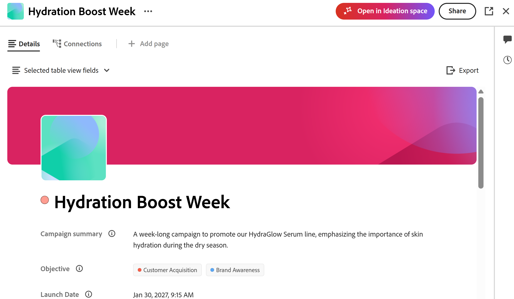

# Introducción al espacio de ideación para Adobe Workfront Planning

<!--
Should we add a new Feature to ExL for "Strategic Ideation"?
-->

<!--
information in this article come from this document, in addition to my notes for this project up to August 31, 2026:
https://adobe-my.sharepoint.com/:w:/r/personal/alinaw_adobe_com/_layouts/15/Doc.aspx?sourcedoc=%7B513DE769-B70B-4040-8C9E-6A9B8E3167BB%7D&file=getting-started-catalyze.docx&action=default&mobileredirect=true
-->

La información de esta página hace referencia a una funcionalidad que aún no está disponible de forma general. Solo está disponible como parte del programa **Beta** del espacio de ideación. \

>[!IMPORTANT]
>
>La información de este artículo hace referencia a Adobe Workfront Planning. Su empresa debe adquirir un paquete de Planning adicional para acceder a Workfront Planning.
>
>La funcionalidad que se describe aquí no está disponible si su organización ha adquirido Workfront Planning como producto independiente.
>
>Para obtener información general sobre Workfront Planning, consulte [Introducción a Adobe Workfront Planning](/help/quicksilver/planning/general/planning-overview.md).
> 
>

<!--
Future - when they make it available in Planning: replace the above with this OR ... insert the snippet:

>[!IMPORTANT]
>
>The information in this article refers to Adobe Workfront Planning which your organization can purchase either as an Adobe Workfront package or a standalone product. 
>
>Not all capabilities included in the Planning package are available to Workfront Planning when it is purchased as a standalone product. 
>
>For general information about Workfront Planning, see [Get started with Adobe Workfront Planning](/help/quicksilver/planning/general/planning-overview.md).
> 
>For information about Workfront Planning as a standalone product, see [Get started with Adobe Workfront Planning as a standalone product](/help/quicksilver/planning/planning-sta/planning-sta-overview.md). 
>
-->

El espacio de ideación de Adobe es la capacidad de ideación estratégica basada en IA de Adobe, integrada directamente en Workfront Planning. Proporciona a los equipos de marketing un punto de partida estructurado y basado en datos para la estrategia de campaña, y reemplaza la investigación manual y las conjeturas por informes generados por IA basados en el historial de rendimiento real de una organización.

Accesible solo desde Workfront Planning o el menú principal de Workfront, el espacio de ideación se encuentra en la parte delantera del ciclo vital de la campaña, antes de la planificación, la producción y la entrega, y se alimenta directamente en el espacio de trabajo de Workfront Planning donde los equipos planifican y ejecutan su trabajo.

Los espacios de ideación aprovechan Adobe Enterprise CX Coworker para generar informes que posteriormente puede convertir en registros de Planning o descargar como PDF.

## Disponibilidad del producto

La cronología de la versión planificada para el Espacio de ideas que está sujeta a cambios incluye los siguientes hitos:

* **Beta cerrado:** lanzado en julio de 2026 para un número reducido de clientes.

  El espacio de ideación está disponible en el entorno de producción para los clientes participantes.
* **Abrir Beta:** con destino el 12 de noviembre de 2026. Esta es una oferta de inclusión en la que debe activar activamente la opción en lugar de excluirse de ella de forma activa.

  El espacio de ideación está disponible en los entornos Producción, Vista previa y Espacio aislado para todos los clientes que cumplan todos los demás requisitos.

* **Disponibilidad general:** Segmentado para el 1 de febrero de 2027.

## Requisitos de idoneidad del producto

<!--section duplicated here: help/quicksilver/planning/ideation/access-needed-to-use-ideation-space.md-->

>[!NOTE]
>
>No necesita un inicio de sesión independiente para acceder al espacio de ideación. Está disponible de inmediato si puede iniciar sesión en Workfront si también tiene Workfront Planning.
>
>Para obtener más información sobre el acceso necesario para usar el espacio de ideación, consulte [Acceso necesario para usar el espacio de ideación](/help/quicksilver/planning/ideation/access-needed-to-use-ideation-space.md).

Puede acceder al espacio de ideación si su organización y usted tienen acceso a lo siguiente:

* Proveedores de nube:

  * Amazon Web Service (AWS)

    Los proveedores de Azure y GCP no son compatibles.

* Productos:

  * Adobe Workfront con Workfront Planning
  * CX Enterprise Coworker en Workfront

    >[!IMPORTANT]
    >
    >CX Enterprise Coworker no está disponible actualmente para organizaciones de atención médica, finanzas u otros sectores con datos confidenciales. El asistente de IA está disponible para estas organizaciones, pero el espacio de ideación no está disponible para los clientes de Workfront que no tienen Compañero de trabajo.

* Paquetes de Adobe: <!--Et wanted the Coworker added to these-->

  * Durante la versión de Open Beta (a partir del 12 de noviembre de 2026), debe tener lo siguiente:

    * Un paquete de flujo de trabajo de Adobe Workfront con un paquete de Workfront Planning con Adobe CX Enterprise Coworker activado

  * Después del lanzamiento de Disponibilidad general (previsto para el 1 de febrero de 2027), puede tener una de las siguientes opciones:

    * Un paquete de flujo de trabajo de Adobe Workfront con un paquete de Workfront Planning
    * Adobe Workfront Planning como producto independiente

    Ambos paquetes deben tener Adobe CX Enterprise Coworker activado

* Licencia de Adobe Workfront:

  * Administradores del sistema de flujo de trabajo y planificación o usuarios con licencia estándar

Para obtener más información, consulte [Acceso necesario para utilizar el espacio de ideación](/help/quicksilver/planning/ideation/access-needed-to-use-ideation-space.md).

<!--not required anymore: * Adobe GenStudio for Performance Marketing-->

<!-- only required for closed beta, see below: * Adobe Customer Journey Analytics-->

<!--
No longer required or recommended, per Et:

In addition to above requirements, you must also meet the following criteria to participate in the Closed Beta program: 

* Have an active Adobe Customer Journey Analytics (CJA) account with campaign tracking in place
* Have multi-channel campaigns with a repeatable planning process
* Actively use Workfront Planning for marketing operations
* Have at least one identified strategist or ideation user who will be the primary Ideation space user
-->

## Obtener acceso al espacio de ideación

Para obtener acceso al espacio de ideación:

1. Compruebe que cumple los requisitos del producto tal como se describe en la sección [Requisitos del producto](#product-requirements) de este artículo.
1. Póngase en contacto con el representante de su cuenta de Adobe para expresar interés en participar en el Beta cerrado o únase a Open Beta, cuando esté disponible.

   Los administradores del sistema tienen acceso al espacio de ideación de forma predeterminada y no pueden eliminarlo cuando está disponible en Open Beta. Pueden activarlo todos los demás usuarios en cualquiera de los entornos siguientes:

   * Producción
   * Vista previa
   * Zonas protegidas personalizadas

1. Como administrador del sistema, haga lo siguiente:

   * Active la configuración Herramientas de Coworker y MCP en las Preferencias del sistema para permitir el acceso a Coworker para toda la compañía.
   * Desactive la siguiente configuración para los usuarios con licencia estándar en sus niveles de acceso:
     * Desactive el panel CX Coworker en Workfront
     * Deshabilitar espacio de ideación

   Para obtener más información sobre el uso del espacio de ideación, consulte también los siguientes artículos:

   * [Acceso necesario para utilizar el espacio de ideación](/help/quicksilver/planning/ideation/access-needed-to-use-ideation-space.md)
   * [Creación de registros de Planning a partir de informes del espacio de ideación](/help/quicksilver/planning/ideation/create-records-in-ideation-space-for-planning.md)
   * [Crear informes en el espacio de ideación](/help/quicksilver/planning/ideation/create-briefs-in-ideation-space.md)

1. (Recomendado) Identifique su primera campaña: una reciente para actualizar o una nueva iniciativa para crear desde cero.

## Busque el espacio de ideación

Una vez que se haya asegurado de tener acceso a los productos, paquetes, sistema y nivel de acceso adecuados configurados, podrá localizar el espacio de ideación en las siguientes áreas de Workfront:

* En el menú principal de Workfront, abra el área Espacio de ideación

  

* En Workfront Planning, cuando se agrega manualmente un nuevo registro

  

* En Workfront Planning, al editar un registro existente

  

>[!TIP]
>
>No se puede quitar el área del espacio de ideación del menú Principal mediante una plantilla de diseño. Para obtener más información sobre cómo bloquear el acceso de un usuario al espacio de ideación, consulte [Acceso necesario para utilizar el espacio de ideación](/help/quicksilver/planning/ideation/access-needed-to-use-ideation-space.md).
>

## Espacio de ideación y Adobe CX Enterprise Coworker

El espacio de ideación utiliza Adobe CX Enterprise Coworker como interfaz de mensajes.

Los usuarios pueden hacer preguntas de seguimiento y refinar una breve conversación en lugar de obtener un solo resultado de una sola toma.

Cuando se vincula una información breve a un registro activo de Workfront Planning, el colaborador evita sobrescribirla para que el plan subyacente permanezca intacto. El registro solo se anula al exportar la información a Workfront Planning.

<!--
Previous intro but oped for the more direct one above: 
The Ideation space is a collaborative strategic marketing ideation tool for brand and product marketers to build stronger campaigns faster and with better team alignment. It grounds AI suggestions in real-marketing context — past briefs, performance data, audience insights, brand guidelines, and existing campaign assets — so results are relevant, not generic.

Ideation space works exclusively with the CX Enterprise Coworker for Workfront as the prompting agent for all its capabilities. 
-->

A continuación se indican algunas de las funciones de Coworker cuando se utiliza en el espacio de ideación:

* Realice análisis de alternativas para comparar diferentes temas de campañas, mensajes o probar su dirección estratégica
* Carga de documentos o perspectivas sociales
* Acceda al contenido web pertinente a la información que está creando
* Definir un objetivo de campaña
* Obtener un resumen de las perspectivas de audiencia
* Generación de personalidades de audiencia
* Ideación de mensajes de campaña
* Trabaje en un lienzo visual grande, utilizando las indicaciones de IA para generar texto, imágenes, archivos, gráficos y tarjetas de insight
* Organice, revise y expanda las tarjetas para, finalmente, traducirlas en informes de campañas
* Colabore con varios usuarios que puedan agregar ideas, dejar comentarios sobre elementos específicos del lienzo o utilizar notas adhesivas para ideas de forma libre antes de finalizar un informe
* Recomendamos las siguientes prácticas recomendadas al utilizar Coworker en el espacio de ideación:

  * **Sea específico**. Las descripciones de campaña más ricas producen tarjetas más relevantes y mejor fundamentadas.
  * **Verificar antes de finalizar**. Las respuestas generadas por IA pueden ser inexactas, así que siempre verifique **Fuentes** en una tarjeta y confírmela con las fuentes vinculadas antes de finalizar un registro.
  * **Mezclar tarjetas de IA con registros reales**. Arrastre y suelte los registros reales en el espacio de ideación.

## Audiencia y casos de uso

El espacio de ideación está diseñado para los especialistas en marketing de productos y marcas responsables de dar forma a la estrategia de campaña y producir informes de campaña.

<!--
Too much: 

| Role | Primary job to be done |
|---|---|
| Brand Marketer | Identify messaging, trends, and cultural shifts that resonate with target audiences |
| Product Marketer | Launch insight-driven, culturally relevant campaigns that deliver business impact |
| Collaborators | Internal creative studios, external agencies, media planners/managers, and executives who need visibility into strategic direction |
-->

Como administrador del espacio de trabajo, puede utilizar el espacio de ideación para crear registros en Workfront Planning siguiendo los pasos siguientes:

* Cree un informe en el espacio Ideación después de iniciarlo desde Planning, a medida que empiece a crear o editar registros.
* Utilice las indicaciones de IA para recopilar detalles de otros registros del sistema o de la web y terminar de crear informes de ideas.
* Cree tipos de registros de Planning a partir de los informes.
* Refine los informes de ideación y actualice los tipos de registros existentes en Planning.

Los siguientes son casos de uso para cómo utilizar el espacio de ideación:

* **Actualizar una campaña anterior con rendimiento histórico**

  * Por ejemplo, puede actualizar las campañas existentes para un nuevo trimestre, temporada o momento de producto.
  * Esto produce un &quot;informe delta&quot; basado en el rendimiento anterior que describe lo que permanece, qué cambia y por qué.

* **Crear una nueva campaña usando el rendimiento histórico**

  * Por ejemplo, puede crear una campaña al lanzar un nuevo producto, segmento o iniciativa sin historial de campaña directa.
  * Esto produce una nueva información a través de la ideación guiada, una combinación de canales recomendada y las direcciones iniciales del concepto o el mensaje.

## Objetos generados por el espacio de ideación

Puede utilizar el espacio de ideación para intercambiar ideas y formular ideas que luego pueda convertir en elementos importantes para el flujo de trabajo.

El espacio de ideación toma todas sus ideas e información de fuentes internas o externas (web) y crea un informe. Después de decidir que la información se ha completado, puede exportarla a los siguientes archivos u objetos:

* Uno de los siguientes formatos de archivo: PDF, Word, PowerPoint, plantilla de Powerpoint
* Un registro de Planning

  Sólo puede exportar un informe a un registro de Planning cuando tiene acceso al espacio de ideación desde Workfront Planning o cuando conectó previamente un registro de Planning a un informe de ideación.

<!--
**************** CONSIDER INCLUDING THIS INFORMATION FROM JESH BARLOW ABOUT COWORKER IN CATALYZE?? - https://adobecorpdev.slack.com/archives/C091C0Y735W/p1788917610365089?thread_ts=1788917251.550099&cid=C091C0Y735W

Catalyze Coworker needs — panel inside Catalyze, not a rail from Unified ShellWhy this matters. Catalyze is AI-first. You can't use it without a prompt, so the prompting surface can't be something you open and close from Unified Shell. Coworker's rail was built to bolt onto apps that already work fine without AI. We need the opposite.

What we need

* Coworker embedded as a panel inside Catalyze (the Photoshop/Illustrator model), always present, minimized or expanded, never fully closeable.
* Not the Unified Shell rail that slides in, pushes the app, and only opens and closes from the shell.
* Quick terminology flag, since Coworker inverts it. By "panel" we mean embedded in the app. Their team uses "panel" for the shell version, so we have to be explicit every time.

Must-haves

* Minimized and expanded prompt bar states that live inside Catalyze, not tied to the shell.
* Minimize, never close. There's no state where the prompt disappears.
* Full UI control over how the prompt behaves.
* Headless Coworker so the panel can always sit on the canvas.

Where it stands (Aug 20 Shell/Catalyze sync with Stephen Gould)

* Headless is technically possible. Coworker can be hosted in Catalyze's own front-end.
* But Horia's team has no capacity to build or own an in-app rail. Deeper embedding means Catalyze eng builds the panel and owns it going forward.
* The open question is ownership, one-time integration vs owning the panel long-term. Still unresolved, and it's the thing that decides this.

Worth noting

* Experience Workspace and Brand Visibility (AM) already run Coworker without the shell, so headless isn't net-new. Let's learn how they did it before anyone calls it infeasible.
* Next step everyone agreed on is getting clarity from Horia's team and Joshua on rail ownership.

*************************************
-->

<!--
## Additional resources

* [Adobe Workfront Campaign Planning](https://business.adobe.com/products/workfront/campaign-planning.html)
* [Adobe Workfront Planning documentation](/help/quicksilver/planning/planning-information.md)
* [Adobe GenStudio Overview](https://business.adobe.com/products/genstudio.html)
* [Adobe Customer Journey Analytics](https://business.adobe.com/products/adobe-analytics/customer-journey-analytics.html)

-->

<!--

Not sure if we should disclose this: 

## The problem the Ideation space solves

Before the Ideation space, campaign strategy relied on two slow, manual processes:

- **Gathering insights** — fragmented, time-consuming, and difficult when no prior audience data exists
- **Aligning stakeholders** — without a shared, data-backed "hook," executives, creatives, and channel partners often work from different assumptions, causing rework and delays

The Ideation space automates insight synthesis and generates a structured brief that gives everyone a shared starting point.
-->

<!--
## What's included, phase by phase

| Phase | Timeline | What's included |
|---|---|---|
| Closed Beta | July 2026 | Limited customers/users/campaigns; core agent skills (strategy framing, messaging ideation, audience definition, data ingestion, brief generation); CJA data integration |
| Open Beta | ~Sept 2026 (planned) | Quality/performance improvements; CJA integration refinements; Workfront Planning handoff; data visualization; Planning workspace structure ingestion; Unity/Conversational UI integration |
| General Availability | H2 2026 (planned) | Bring Your Own Data Source (BYODS); Workfront/Workfront Planning data integration; audience data integration; social data integration; workflow ingestion; strategy testing capabilities |

At GA, the Ideation space is also expected to be accessible through the GenStudio Home conversational UI, running as part of Adobe's Agent Orchestrator suite of agents.
-->