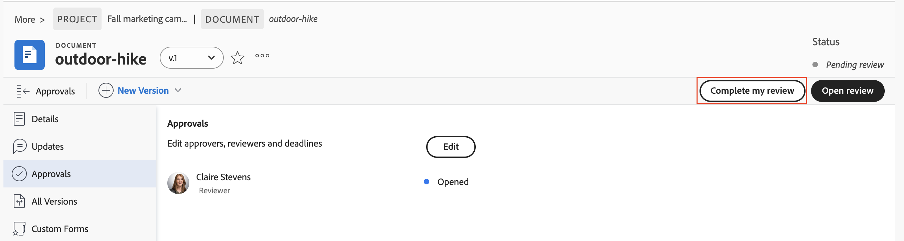
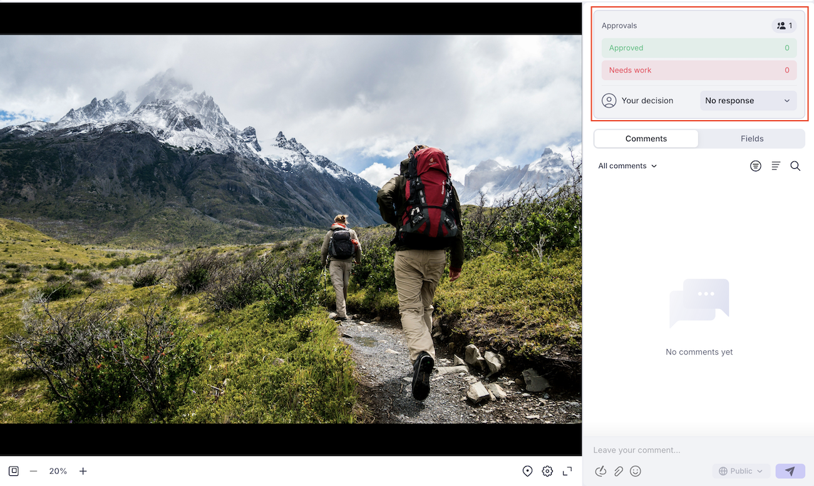

# Revisión y aprobación con el visor Frame.io

{{highlighted-preview}}

Puede revisar y aprobar documentos en Workfront mediante el visor Frame.io.

La revisión de documentos de Workfront con el visor Frame.io le permite dejar comentarios o marcar secciones específicas de un documento, imagen o vídeo para colaborar eficazmente con su equipo y garantizar que los comentarios sean claros y procesables.

Para obtener más información sobre la integración de Frame.io con Workfront, consulte [Resumen unificado de revisión y aprobación](/help/quicksilver/review-and-approve-work/document-reviews-and-approvals/document-approvals-overview.md).

## Requisitos de acceso

+++ Expanda para ver los requisitos de acceso para la funcionalidad en este artículo.

<table style="table-layout:auto"> 
 <col> 
 </col> 
 <col> 
 </col> 
 <tbody> 
  <tr> 
   <td role="rowheader">Paquete de Adobe Workfront</td> 
   <td> 
Cualquier paquete de Workfront para administrar aprobaciones mediante el almacenamiento heredado de Workfront.

Cualquier paquete de flujo de trabajo para administrar aprobaciones mediante el almacenamiento en la nube de Adobe
 </td> 
  </tr> 
  <tr> 
   <td role="rowheader">Licencias de Adobe Workfront</td> 
   <td> 
Solicitud o superior

   
Colaborador o superior
 </td> 
  </tr> 
  <tr data-mc-conditions=""> 
   <td role="rowheader">Configuraciones de nivel de acceso</td> 
   <td> 
Acceso de edición a documentos
 </td> 
  </tr> 
  <tr data-mc-conditions=""> 
   <td role="rowheader">Permisos de objeto</td> 
   <td> 
Editar acceso al objeto asociado con el documento
 </td> 
  </tr> 
 </tbody> 
</table>

Para obtener más información, consulte [Requisitos de acceso en la documentación de Workfront](/help/quicksilver/administration-and-setup/add-users/access-levels-and-object-permissions/access-level-requirements-in-documentation.md).

+++

## Requisitos previos

* Debe tener la integración de Workfront y Frame.io configurada en la instancia de Workfront. Para obtener más información, vea [Resumen de revisión y aprobación unificadas](/help/quicksilver/review-and-approve-work/document-reviews-and-approvals/document-approvals-overview.md#integration-requirements).
* Para revisar un documento de vínculo web, necesitas instalar la extensión [Frame.io de Chrome](https://chromewebstore.google.com/detail/frameio/ppppcfnokinhahidobbfppdahipiejen). Si no está instalado, se le pedirá que lo descargue la primera vez que abra el visor Frame.io para un documento de vínculo web en Workfront.

## Revisar un documento

Como revisor, puede agregar comentarios a y marcar recursos. Una vez finalizada, puede marcar su revisión como completada en Workfront. No es necesario marcar la revisión como completada para que el recurso avance en el proceso de aprobación.

1. Vaya a la notificación de correo electrónico de revisión y haga clic en **Ir a revisión**.
o
Vaya a la página de inicio de Workfront, busque el widget Mis aprobaciones y haga clic en **Abrir revisión**.

   >[!NOTE]
   > 
   >Es posible que tenga que agregar el widget Mis aprobaciones a la página de inicio. Para obtener más información, consulte [Agregar, editar o quitar widgets en Inicio](/help/quicksilver/workfront-basics/using-home/using-the-home-area/add-edit-remove-widgets-in-new-home.md).

1. En Frame.io, utilice las herramientas de comentarios para dejar comentarios o hacer preguntas.
Los comentarios y el marcado de recursos solo son visibles en el visor de Frame.io. Los comentarios no se muestran en Workfront. Sin embargo, el panel de comentarios del documento de Workfront muestra una llamada con un recuento de esos comentarios, cuando hay un recuento disponible, y un vínculo para abrir el visor Frame.io y leerlos. Para obtener más información sobre el uso del visor Frame.io, consulte [Comentarios sobre el contenido](https://help.frame.io/en/articles/9105251-commenting-on-your-media).
1. Una vez que esté satisfecho con el documento, vuelva a la página de detalles del documento en Workfront y marque la revisión como completada.

   

## Aprobar un documento

Como aprobador, puede agregar comentarios y marcar como recursos. Debe tomar la decisión de adelantar el proceso de aprobación.

El documento no pasa a un estado aprobado hasta que todos los aprobadores asignados eligen &quot;aprobado&quot;.

Para tomar una decisión sobre un documento:

1. Vaya a la notificación de correo electrónico de revisión y haga clic en **Ir a revisión**.
o
Vaya a la página de inicio de Workfront, busque el widget Mis aprobaciones y haga clic en **Abrir revisión**.

   >[!NOTE]
   > 
   >Es posible que tenga que agregar el widget Mis aprobaciones a la página de inicio. Para obtener más información, consulte [Agregar, editar o quitar widgets en Inicio](/help/quicksilver/workfront-basics/using-home/using-the-home-area/add-edit-remove-widgets-in-new-home.md).

1. En Frame.io, utilice las herramientas de comentarios para dejar comentarios o hacer preguntas. Los comentarios y el marcado de recursos solo son visibles en el visor de Frame.io. Para obtener más información sobre el uso del visor Frame.io, consulte [Comentarios sobre el contenido](https://help.frame.io/en/articles/9105251-commenting-on-your-media).

   >[!NOTE]
   >
   > En la vista previa, el panel Comentarios de Workfront muestra un mensaje que le permite saber cuándo hay nuevos comentarios disponibles en Frame.io.

1. Una vez que esté satisfecho con el documento, puede elegir una de las siguientes decisiones en el visor de Frame.io:

   * **Aprobar**: el recurso no necesita cambios y está listo para usarse.
   * **Necesita trabajo**: el recurso necesita cambios y no está listo para usarse. Una vez realizados los cambios especificados, el recurso debe cargarse como una nueva versión y pasar por otra ronda de aprobaciones. Para obtener más información, vea [Cargar una nueva versión del documento y solicitar la aprobación](/help/quicksilver/review-and-approve-work/document-reviews-and-approvals/manage-document-approvals/upload-new-doc-version.md). <!--do they need to tell someone it was uploaded via comment tagging?-->

   Una vez que tome una decisión, se notifica al propietario del documento por correo electrónico.

   Para obtener más información sobre las decisiones en Workfront, consulte [Resumen del estado de decisión del documento](/help/quicksilver/review-and-approve-work/document-reviews-and-approvals/manage-document-approvals/document-approval-status.md).

   

## Revisión de un vínculo web

Si el documento es una URL web activa, puede revisar la página en el visor de Frame.io y dejar comentarios directamente en la página.

1. Vaya a la notificación de correo electrónico de revisión y haga clic en **Ir a revisión**.
o
Vaya a la página de inicio de Workfront, busque el widget Mis aprobaciones y haga clic en **Abrir revisión**.

   >[!NOTE]
   > 
   >Es posible que tenga que agregar el widget Mis aprobaciones a la página de inicio. Para obtener más información, consulte [Agregar, editar o quitar widgets en Inicio](/help/quicksilver/workfront-basics/using-home/using-the-home-area/add-edit-remove-widgets-in-new-home.md).

1. En Frame.io, abra el documento de vínculo web. Si se le solicita, instale la extensión de Chrome [Frame.io](https://chromewebstore.google.com/detail/frameio/ppppcfnokinhahidobbfppdahipiejen) para que pueda ver la página y capture el estado actual de la dirección URL.

1. Utilice el visor para agregar comentarios, anotaciones, etc. directamente en la página.

1. Una vez que haya terminado de revisar el documento de vínculo web, puede elegir una de las siguientes decisiones en el visor de Frame.io:

   * **Aprobar**: el recurso no necesita cambios y está listo para usarse.
   * **Necesita trabajo**: el recurso necesita cambios y no está listo para usarse. Una vez realizados los cambios especificados, el recurso debe cargarse como una nueva versión y pasar por otra ronda de aprobaciones. Para obtener más información, vea [Cargar una nueva versión del documento y solicitar la aprobación](/help/quicksilver/review-and-approve-work/document-reviews-and-approvals/manage-document-approvals/upload-new-doc-version.md). <!--do they need to tell someone it was uploaded via comment tagging?-->

   Una vez que tome una decisión, se notifica al propietario del documento por correo electrónico.

Para obtener instrucciones detalladas sobre cómo ver y revisar las URL web activas, incluidas las URL admitidas, los requisitos de extensión del explorador y las opciones de comentarios, consulte [Revisión de HTML para Frame.io](https://help.frame.io/en/articles/12893213-html-review-for-frame-io).