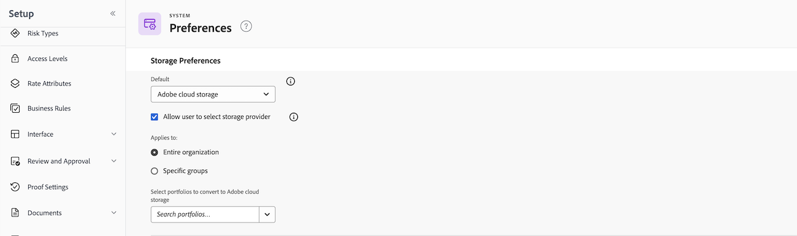

# Planifique la implementación de Adobe Cloud Storage

Usted decide cómo y cuándo llega el almacenamiento en la nube de Adobe a sus usuarios. Nada cambia hasta que un administrador de Workfront establece el almacenamiento en la nube de Adobe como la opción de almacenamiento predeterminada en el área de configuración, por lo que tiene tiempo para probar la experiencia y preparar a sus equipos antes de que alguien trabaje en ella.

Este artículo explica las configuraciones de despliegue que puede elegir, cómo pilotar con un solo grupo y el orden de trabajo sugerido.

## Elija cómo se despliega el almacenamiento en la nube de Adobe

Existen dos configuraciones y puede aplicar una a toda la organización o a grupos específicos de Workfront. Todos los proyectos creados en el almacenamiento en la nube de Adobe utilizan aprobaciones unificadas y el visor Frame.io de forma predeterminada.

Para obtener instrucciones paso a paso, consulte [Habilitar el almacenamiento en la nube de Adobe para su organización](/help/quicksilver/administration-and-setup/set-up-workfront/configure-system-defaults/enable-esm.md).

### Opciones de configuración

* **Solo almacenamiento en la nube de Adobe**: Los nuevos proyectos usan el almacenamiento en la nube de Adobe de forma predeterminada. Los usuarios no pueden crear proyectos heredados.
* **Almacenamiento en la nube de Adobe y almacenamiento heredado de Workfront**: Cuando los usuarios crean un proyecto, eligen entre almacenamiento en la nube de Adobe (con la etiqueta &quot;Nuevo proyecto&quot;) y almacenamiento heredado de Workfront (con la etiqueta &quot;Almacenamiento heredado&quot;). Esta opción está habilitada al seleccionar la casilla de verificación **Permitir al usuario seleccionar el proveedor de almacenamiento** en el área de configuración.

>[!TIP]
>
>Para poner el almacenamiento en la nube de Adobe delante de un equipo más pequeño primero, aplique cualquiera de las configuraciones a un solo grupo de Workfront. Esto permite ejecutar una prueba piloto de destino antes de desplegar de forma más amplia. Se recomienda comenzar con un despliegue a nivel de grupo para un ritmo controlado y luego expandirse a toda la organización una vez que el grupo piloto haya validado la experiencia.

Los objetos existentes mantienen el modelo de almacenamiento con el que se crearon. Al cambiar la preferencia de almacenamiento predeterminada, no se cambia ningún objeto existente.

## Planificación del despliegue

Cada entorno de Workfront es diferente. Antes de establecer el almacenamiento en la nube de Adobe como predeterminado para los usuarios, dedique un tiempo a planificar el aspecto de un despliegue correcto para su organización. Las sugerencias a continuación no son una lista de comprobación exacta, sino un punto de partida para su propio plan.

### Elija un grupo piloto

Un despliegue con alcance de grupo le permite poner el almacenamiento en la nube de Adobe delante de un equipo más pequeño primero, recopilar comentarios y ajustar antes de un despliegue más amplio. Elija un grupo cuyos patrones de trabajo sean lo suficientemente representativos como para que aparezcan los problemas que desea conocer antes.

<!--
>[!IMPORTANT]
>
>Only members of the pilot group can convert an Adobe cloud storage object, such as a request or a task, into a project. Users outside the group, including Workfront administrators, see the error "User is not eligible for this operation."
-->

### Haga la prueba antes de empezar

El almacenamiento en la nube de Adobe está disponible en entornos de zona protegida de Workfront, por lo que puede validar gran parte de la experiencia antes de la producción. El visor Frame.io no está disponible en la zona protegida, por lo que puede validar la experiencia completa de revisión y aprobación en producción con su grupo piloto. Para obtener más información, consulte [Habilitar el almacenamiento en la nube de Adobe para su organización](/help/quicksilver/administration-and-setup/set-up-workfront/configure-system-defaults/enable-esm.md).

### Comunicar el cambio a los usuarios finales

El mayor cambio visible para los revisores, aprobadores y propietarios de proyectos es el nuevo área Documentos y el visor Frame.io, que permite la revisión y aprobación de proyectos de almacenamiento en la nube de Adobe. Planifique cómo introducirá estos elementos para que los usuarios sepan qué esperar cuando se encuentren con su primer proyecto de almacenamiento en la nube de Adobe. El artículo [Introducción a la revisión y aprobación unificadas](/help/quicksilver/review-and-approve-work/get-started-with-unified-approvals.md) es un punto de partida útil para el material de cara al usuario final.

### Revisión de los permisos y el control

En los proyectos de almacenamiento en la nube de Adobe, tanto Administrar como Contribuir se asignan a Editar y compartir en Frame.io, que incluye el uso compartido externo. Revise sus patrones de uso compartido y decida si se adapta a su modelo de gobernanza antes de llevar a los equipos al almacenamiento en la nube de Adobe. Para obtener más información, consulte [Novedades del almacenamiento en la nube de Adobe](/help/quicksilver/review-and-approve-work/adobe-cloud-storage-whats-different.md#object-permissions-mapping).

### Plantillas de auditoría y nomenclatura

El almacenamiento en la nube de Adobe aplica reglas de nomenclatura estrictas y Workfront cambia automáticamente el nombre de los objetos que entran en conflicto con ellas. Si crea proyectos a partir de plantillas, revise esas plantillas para que los nombres y la estructura que generan se ajusten a las reglas. Para obtener más información, consulte [Novedades del almacenamiento en la nube de Adobe](/help/quicksilver/review-and-approve-work/adobe-cloud-storage-whats-different.md#object-naming-rules).

### Planifique con Workfront Fusion

Los escenarios de Fusion basados en pruebas existentes siguen funcionando en proyectos heredados, pero no funcionan automáticamente con proyectos de almacenamiento en la nube de Adobe. Antes de llevar los equipos que dependen de esos escenarios al almacenamiento en la nube de Adobe, clasifique cada escenario como Editar, Reconstruir o Retirar. Para obtener más información, consulte [Actualizar escenarios de Workfront Fusion para una revisión y aprobación unificadas](/help/quicksilver/review-and-approve-work/tips-tricks-troubleshooting-approvals/fusion-remediation-for-unified-approvals.md).

### Plan para informar de cambios

Los datos de flujo de trabajo de aprobación unificada y los informes aparecen en paneles de lienzo. Los informes de aprobación heredados no se transfieren automáticamente, por lo que debe configurar un tablero de reemplazo antes de que los equipos piloto lo necesiten. Para obtener más información, consulte [Crear un tablero de informes para revisión y aprobaciones](/help/quicksilver/review-and-approve-work/document-reviews-and-approvals/create-review-and-approval-dashboard.md).

## Secuencia sugerida

Utilice este orden como plantilla para ajustarlo a su entorno:

1. Pruebe la experiencia en una zona protegida y con un grupo piloto en producción.
2. Clasifique y actualice sus escenarios de Fusion y cree sus informes de paneles de lienzo.
3. Audite las plantillas y revise los permisos y el modelo de uso compartido.
4. Comunique el cambio a los revisores, aprobadores y propietarios de proyecto que lo utilizarán.
5. Establezca el almacenamiento en la nube de Adobe como predeterminado para el grupo piloto y, a continuación, expanda a más grupos o a toda la organización una vez que el programa piloto valide la experiencia.
