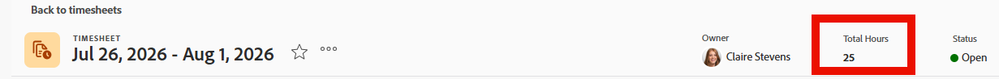

# Ver las horas totales en la plantilla de horas

<!--Audited: 8/2024-->

Puede ver la cantidad total de horas en su plantilla de horas. El número total de horas de la plantilla de horas incluye las horas registradas en proyectos, tareas, problemas y todas las horas generales.

El total de horas refleja las horas enviadas mediante la plantilla de horas, el área Actualizaciones o el área Horas para los proyectos, tareas o problemas.

## Requisitos de acceso

+++ Expanda para ver los requisitos de acceso para la funcionalidad en este artículo. 

<table style="table-layout:auto"> 
 <col> 
 <col> 
 <tbody> 
  <tr> 
   <td>Paquete de Adobe Workfront</td> 
   <td> 
Cualquiera
 </td> 
  </tr> 
  <tr> 
   <td>Licencia de Adobe Workfront</td> 
   <td> 
Ligero o superior 

   
Revisión o superior
 </td> 
  </tr> 
  <tr> 
   <td>Configuración de nivel de acceso</td> 
   <td> 
Acceso de visualización o superior a tareas y problemas
 </td> 
  </tr> 
  <tr> 
   <td>Permisos de objeto</td> 
   <td> 
Vista o permisos superiores a tareas y problemas
 </td> 
  </tr> 
 </tbody> 
</table>

Para obtener más información, consulte [Requisitos de acceso en la documentación de Workfront](/help/quicksilver/administration-and-setup/add-users/access-levels-and-object-permissions/access-level-requirements-in-documentation.md).

+++

## Ver las horas totales de una plantilla de horas en el encabezado de la plantilla de horas

Puede ver las horas totales de una plantilla de horas en el encabezado de la plantilla de horas.

## Ver las horas totales en su plantilla de horas en una lista de plantillas de horas

{{step1-to-timesheets}}

De forma predeterminada, se muestran todas las hojas de horas a las que tiene acceso para ver.

1. (Opcional) Realice una de las siguientes acciones para actualizar el filtro en la lista de plantillas de horas:

   * Seleccione **Mis aprobaciones de hojas de horas** en la esquina superior derecha de la página para ver solamente las hojas de horas que usted apruebe,

     O

     Seleccione **Mis plantillas de horas** para ver solamente sus plantillas de horas.

     Esto aplica los filtros **Mis aprobaciones de hojas de horas** o **Mi hoja de horas** a la lista de hojas de horas.

   * Haga clic en el icono **Filtro**  para aplicar un filtro o crear uno nuevo. Para obtener información sobre cómo crear o actualizar filtros, consulte [Crear o editar filtros en Adobe Workfront](../../reports-and-dashboards/reports/reporting-elements/create-filters.md).

   >[!NOTE]
   >
   >Las opciones Mis aprobaciones de hojas de horas y Mis hojas de horas no se muestran en la parte superior de la lista de hojas de horas ni en la lista de filtros si el administrador de Workfront o de un grupo ha eliminado esos filtros de los controles de lista en el área de Configuración o de la plantilla de diseño. Para obtener más información, consulte [Personalizar filtros, vistas y agrupaciones mediante una plantilla de diseño](../../administration-and-setup/customize-workfront/use-layout-templates/customize-fvg-list-controls-layout-template.md).

1. (Opcional) Haga clic en los iconos **Ver**  o **Agrupar**  para aplicar una vista o agrupación o para crear una nueva.

   Para obtener información sobre la creación de filtros, vistas o agrupaciones, consulte los siguientes artículos:

   * [Crear o editar filtros en Adobe Workfront](../../reports-and-dashboards/reports/reporting-elements/create-filters.md)
   * [Crear o editar vistas en Adobe Workfront](../../reports-and-dashboards/reports/reporting-elements/create-edit-views.md)
   * [Creación de agrupaciones en Adobe Workfront](../../reports-and-dashboards/reports/reporting-elements/create-groupings.md)

1. El número total de horas de cada plantilla de horas se muestra en la columna **Total de horas**.

   

   >[!TIP]
   >
   >Al utilizar la vista Estándar para una lista de plantillas de horas, la columna Total de horas se muestra en rojo si la hora registrada para los elementos de la plantilla de horas supera el número de horas en el lapso de tiempo de la plantilla de horas. Para obtener más información, consulte el campo “Total de horas” en [Glosario de terminología de Adobe Workfront](../../workfront-basics/navigate-workfront/workfront-navigation/workfront-terminology-glossary.md).
