# Información general sobre el [!UICONTROL resumen]

{{highlighted-preview}}

Puede usar el panel [!UICONTROL Resumen] para revisar y actualizar la información del elemento de trabajo directamente desde una lista de tareas, problemas, documentos o desde otras áreas de [!DNL Adobe Workfront] que muestran tareas y problemas.

El administrador de Workfront o de grupo puede modificar las áreas y los campos que se muestran en el Panel de resumen. Se pueden añadir hasta 16 campos al panel Resumen.

>[!IMPORTANT]
>
>Se recomienda añadir campos que se deben actualizar con frecuencia al Panel de resumen para poder acceder fácilmente a ellos y actualizarlos sin tener que acceder a la página principal del objeto.
>
>Por ejemplo, puede añadir los siguientes campos actualizados con frecuencia a los paneles Resumen de tareas y problemas:
>
>* Estado
>* Porcentaje completado
>* Fecha de confirmación
>* Fecha planificada de finalización
>* Condición

En la tabla siguiente se muestran las áreas en las que puede encontrar y usar el panel [!UICONTROL Resumen]:

<table style="table-layout:auto"> 
 <col data-mc-conditions=""> 
 <tbody> 
  <tr> 
   <td><b>Tareas</b></td> 
  </tr> 
  <tr> 
   <td> 
Listas de tareas dentro de un
 
    <ul> 
     <li>Proyecto</li> 
     <li>Subtarea</li> 
    </ul> </td> 
  </tr> 
  <tr> 
   <td>Tareas en las áreas de trabajo de [!UICONTROL Unassigned] y [!UICONTROL Assigned] del [!UICONTROL Workload Balancer]</td> 
  </tr> 
   <tr> 
   <td>Tareas en una [!UICONTROL Timesheet]</td> 
  </tr> 
  <tr data-mc-conditions=""> 
   <td><b>Problemas</b></td> 
  </tr> 
  <tr data-mc-conditions=""> 
   <td> 
Listas de problemas dentro de un
 
    <ul> 
     <li>Proyecto</li> 
     <li>Tarea</li> 
     <li>Subtarea</li> 
    </ul> </td> 
  </tr> 
  <tr data-mc-conditions=""> 
   <td>Problemas en el área de [!UICONTROL Assigned Work] del [!UICONTROL Workload Balancer]</td> 
  </tr> 
  <tr data-mc-conditions=""> 
   <td>Problemas en la sección [!UICONTROL Submitted] del área de [!UICONTROL Requests]</td> 
  </tr> 
</tr> 
   <tr> 
   <td>Problemas en una [!UICONTROL Timesheet]</td> 
  </tr>

<tr data-mc-conditions=""> 
   <td><b>Documentos</b></td> 
  </tr> 
  <tr data-mc-conditions=""> 
   <td>Área de [!UICONTROL Documents]</td> 
  </tr> 
  <tr data-mc-conditions=""> 
   <td>Sección de [!UICONTROL Documents] de cualquier objeto (proyecto, tarea, problema, programa, portafolio, plantilla, tarea de plantilla, usuario)</td> 
  </tr> 
 </tbody> 
</table>

<!--

Workfront administrators can customize the Summary in the Layout Template. For more information, see <a href="../../administration-and-setup/customize-workfront/use-layout-templates/create-and-manage-layout-templates.md" class="MCXref xref">Create and manage layout templates</a>.

-->

En este artículo se describe cómo acceder y utilizar el panel [!UICONTROL Resumen] para tareas y problemas en listas.

Para obtener información sobre cómo obtener acceso al [!UICONTROL Resumen] en el [!UICONTROL Distribuidor de cargas de trabajo], consulte [Actualizar elementos de trabajo en el [!UICONTROL Distribuidor de cargas de trabajo] mediante el [!UICONTROL Resumen]](../../resource-mgmt/workload-balancer/update-items-in-summary-panel-in-workload-balancer.md).

Para obtener información sobre cómo acceder al [!UICONTROL Resumen] para documentos, consulte la información general del [[!UICONTROL Resumen] para documentos](../../documents/managing-documents/summary-for-documents.md).

## Ver el panel [!UICONTROL Resumen] en una lista de tareas o problemas

1. Vaya a una tarea o problema y seleccione un elemento de la lista.
1. Haga clic en el icono **[!UICONTROL Abrir resumen]** . Después de abrir el Resumen, permanece abierto a medida que hace clic en otras tareas o problemas o los selecciona y permanece abierto hasta que lo cierra manualmente.

   >[!TIP]
   >
   >Solo puede seleccionar una tarea o un problema a la vez para ver sus detalles en el panel [!UICONTROL Resumen].

   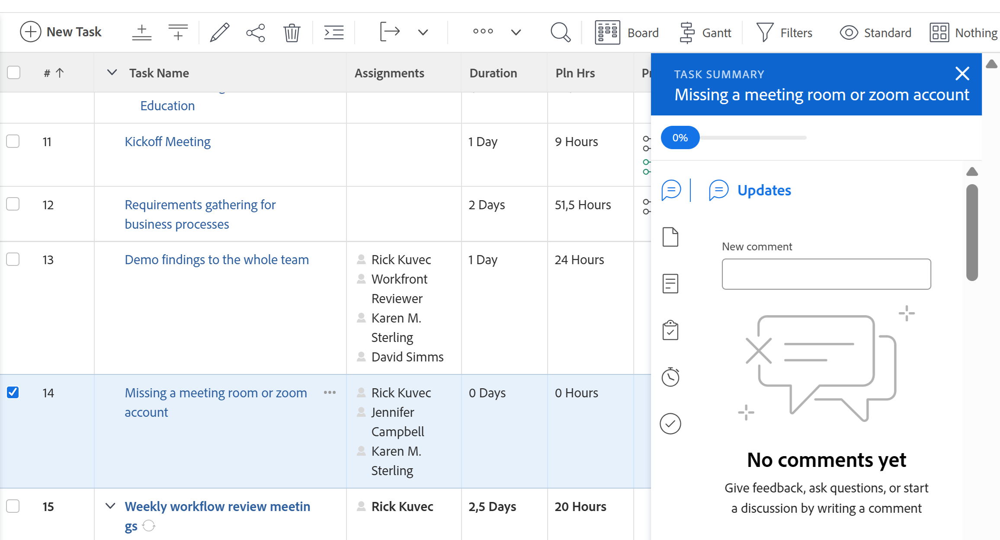

   <!--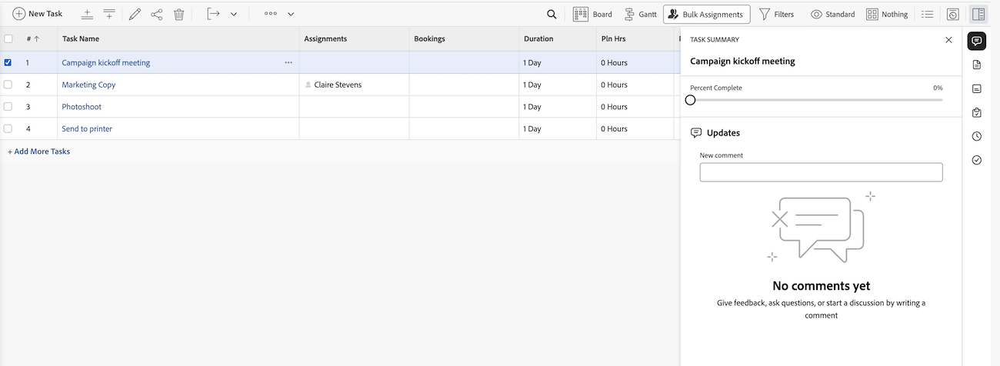-->

1. (Opcional) Para cerrar el panel [!UICONTROL Resumen], siga uno de estos procedimientos:

   * En una tarea o lista de problemas, haga clic en el icono **[!UICONTROL Abrir resumen]** 

     O

     Haga clic en el icono **X** en la esquina superior derecha del panel [!UICONTROL Resumen].

   * En la sección [!UICONTROL Enviadas] del área de [!UICONTROL Solicitudes], haga clic en el icono **[!UICONTROL Cerrar resumen]** 

     O

     Haga clic en el botón **X** en la esquina superior derecha del panel de resumen.

## [!UICONTROL Porcentaje completado]

Use la burbuja azul de progreso en la parte superior de [!UICONTROL Resumen] para actualizar el porcentaje completado de la tarea o el problema que ha seleccionado. Introduzca un número o arrastre la burbuja hasta el porcentaje correcto.

Cuando arrastra y suelta la burbuja en el panel Resumen, el porcentaje completado se actualiza en un punto. No puede introducir un número decimal.

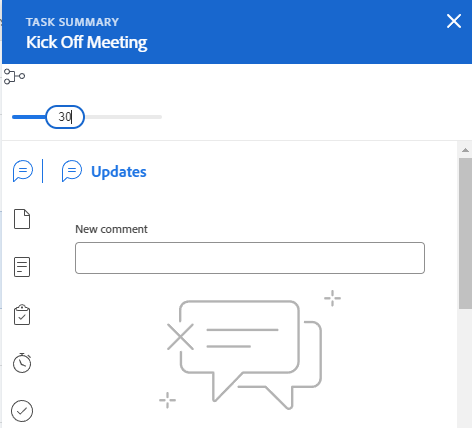

En vista previa:
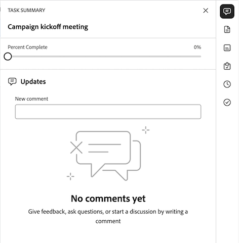

## [!UICONTROL Actualizaciones]

Use la ficha [!UICONTROL Actualizaciones] de [!UICONTROL Resumen] para ver las actualizaciones recientes y realizar actualizaciones sobre la tarea o el problema que seleccionó. Haga clic en **[!UICONTROL Ver todo]** para ir directamente a la pestaña [!UICONTROL Actualizaciones] de la tarea.

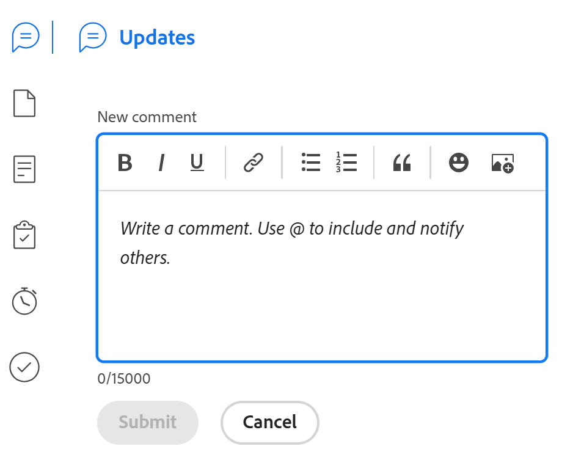

En vista previa:
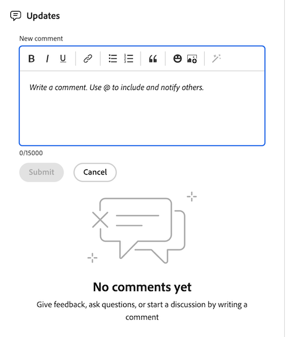

## [!UICONTROL Documentos]

Use la ficha [!UICONTROL Documentos] de [!UICONTROL Resumen] para ver los documentos adjuntos a la tarea o al problema que seleccionó. Haga clic en la miniatura para abrir una vista previa del documento. Para ir directamente a la ficha [!UICONTROL Documentos] en la tarea o problema, haga clic en el título **[!UICONTROL Documentos]**.

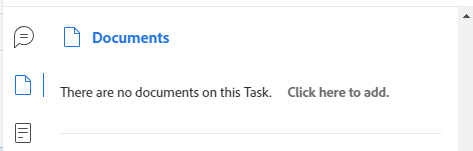

En vista previa:
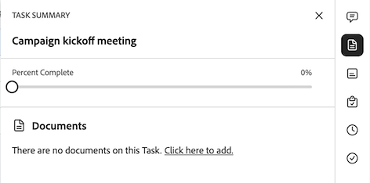

## [!UICONTROL Detalles]

Use la ficha [!UICONTROL Detalles] de [!UICONTROL Resumen] para ver detalles de elementos de trabajo de alto nivel, realizar asignaciones o agregar fechas de inicio. Haga clic en **[!UICONTROL Ver todo]** para ir directamente a la ficha [!UICONTROL Detalles] de la tarea o problema.

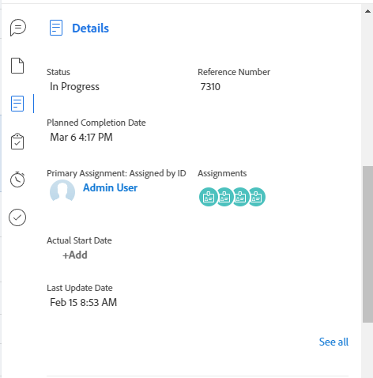

En vista previa:
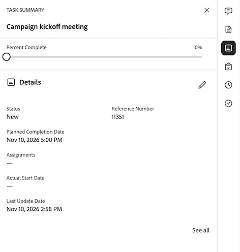

## [!UICONTROL Subtareas]

Esta sección solo está disponible para las tareas. Use la ficha [!UICONTROL Subtareas] de [!UICONTROL Resumen] para ver las subtareas [!UICONTROL Nuevas], [!UICONTROL En curso] y [!UICONTROL Cerradas] de la tarea seleccionada. Haga clic en el menú desplegable **[!UICONTROL Estado]** para cambiar de estado. Para ir directamente a la pestaña [!UICONTROL Subtareas] en la tarea, haga clic en el título **[!UICONTROL Subtareas]**.

Si no ha añadido ninguna subtarea a la tarea, haga clic en **[!UICONTROL Añadir una aquí]** para ir directamente a la ficha [!UICONTROL Subtareas] de la tarea.

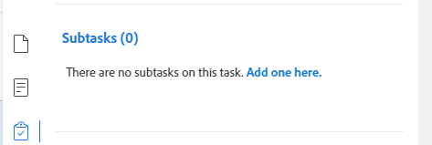

En vista previa:

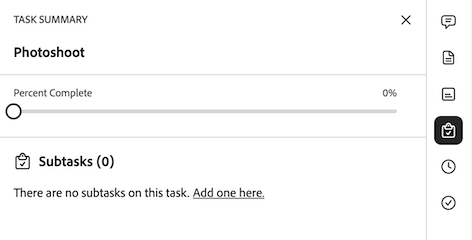

## [!UICONTROL Horas]

Use la ficha [!UICONTROL Horas] de [!UICONTROL Resumen] para registrar horas en la tarea o el problema que seleccionó. Haga clic en **[!UICONTROL Registrar hora]** e introduzca sus horas. Para ir directamente a la ficha Horas en la tarea o problema, haga clic en el título **[!UICONTROL Horas]**.

El recuento de horas en el [!UICONTROL Resumen] muestra las horas que registra. Otros usuarios tendrán diferentes recuentos totales de horas en el [!UICONTROL Resumen], según la hora a la que inicien sesión en la tarea.

Si no hay [!UICONTROL horas] planificadas en la tarea o problema y ha registrado tiempo, la barra de horas se mostrará en rojo.

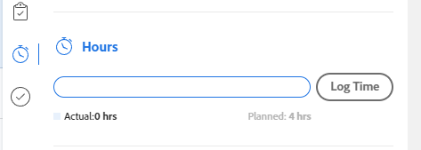

En vista previa:

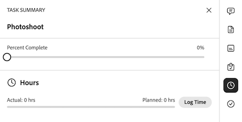

## Aprobaciones

Use la pestaña [!UICONTROL Aprobaciones] de [!UICONTROL Resumen] para ver las aprobaciones adjuntas a la tarea o al problema que seleccionó. Si no ha añadido ninguna aprobación, seleccione una aprobación existente en el menú desplegable o haga clic en **[!UICONTROL Crear proceso de aprobación de un solo uso]** para ir directamente a la pestaña [!UICONTROL Aprobaciones] en la tarea o problema.

Para ir directamente a la pestaña [!UICONTROL Aprobaciones] en la tarea o problema, haga clic en el título **[!UICONTROL Aprobaciones]**.

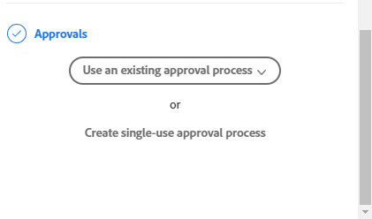

En vista previa:
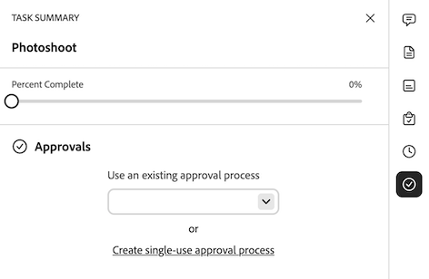

